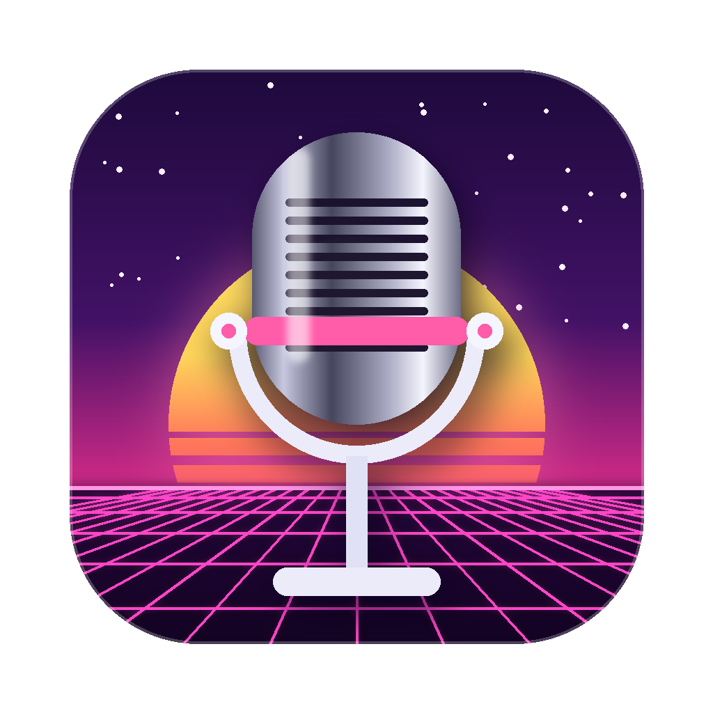

<p align="center">
  
</p>

<h1 align="center">Flow</h1>

<p align="center"><b>Talk anywhere on your Mac. It types for you, fully offline.</b><br>
Free, open-source dictation for Apple Silicon. Your voice never leaves your Mac.</p>

<p align="center"><a href="https://nikolaigeorgie.github.io/flow/">Website</a> · <a href="#install">Install</a> · <a href="#how-it-works">How it works</a></p>

---

Press **Ctrl+Space** in any app, talk, and clean text is pasted where your cursor is. Filler words are removed, punctuation is fixed, and when you correct yourself mid-sentence ("Tuesday, no wait, Thursday") only the correction is kept.

It's a free, local alternative to paid dictation apps:

- **Private.** Speech recognition and cleanup both run on your Mac's GPU. After the one-time model download, Flow makes no network calls.
- **Fast.** About 0.5 s from releasing the key to text appearing, on an M-series Mac.
- **Free.** No account, no subscription, no API keys.
- **Accurate.** Qwen3-ASR plus your own dictionary gets names and jargon right (Supabase, PostHog, your teammates' names…).

<p align="center"></p>

## Install

Requires an **Apple Silicon Mac** (M1 or newer), **macOS 14+**, and about **10 GB** of free disk space.

```sh
curl -fsSL https://raw.githubusercontent.com/nikolaigeorgie/flow/main/install.sh | bash
```

Or [download the zip](https://github.com/nikolaigeorgie/flow/archive/refs/heads/main.zip), unzip it, and right-click **Install.command** → Open.

The installer downloads Flow to `~/.flow`, sets up Python, builds `~/Applications/Flow.app` on your Mac (so macOS shows no "unidentified developer" warning), and adds it to Login Items. Then:

1. Allow **Accessibility** and **Input Monitoring** for Flow in *System Settings → Privacy & Security*. Flow restarts by itself once they're on.
2. The first launch downloads the AI models (about 8 GB, one time only). "Flow is on" appears at the bottom of the screen when it's ready.
3. Allow the microphone the first time you dictate.

## Use

| | |
|---|---|
| **Ctrl+Space** (tap) | Start recording; tap again to stop and paste |
| **Ctrl+Space** (hold) | Push-to-talk; release to paste |
| **Esc** | Cancel; nothing is pasted |

The menu bar mic icon has: **On/Off**, **AI cleanup** toggle, **Edit dictionary…**, **Open at login**, and **Open log**.

**Dictionary:** one word or name per line helps recognition spell it right, and `heard -> wanted` forces a replacement (e.g. `cloud code -> Claude Code`). Changes apply on your next dictation.

> **Can't see the menu bar icon?** On MacBooks with a notch, macOS hides extra icons behind it. Hold ⌘ and drag the Flow icon to the right (on an external display if needed). You can always tell it's running from the "Flow is on" message.

## How it works

```
Ctrl+Space ─▶ mic (only while recording) ─▶ Qwen3-ASR 1.7B ─▶ Qwen3.5-9B cleanup ─▶ ⌘V into your app
                                             speech → text      fillers, fixes
```

| Part | What |
|---|---|
| Speech recognition | [Qwen3-ASR 1.7B](https://huggingface.co/mlx-community/Qwen3-ASR-1.7B-8bit) via [mlx-audio](https://github.com/Blaizzy/mlx-audio) |
| Cleanup | [Qwen3.5-9B](https://huggingface.co/mlx-community/Qwen3.5-9B-MLX-4bit) via [mlx-lm](https://github.com/ml-explore/mlx-lm) |
| Runtime | Apple [MLX](https://github.com/ml-explore/mlx) on the GPU |
| App | Python + PyObjC menu bar app, native key capture and overlay |

These models were chosen by benchmarking against Whisper large-v3-turbo, Parakeet v3 and Qwen3-4B on an M5 Max. They were the most accurate on names and jargon and the only ones that reliably handled self-corrections. To try others, change `ASR` / `LLM` at the top of `flow.py`.

Your dictionary, settings and log are stored in `~/Library/Application Support/Flow/`, outside the code folder.

## Develop

```sh
git clone https://github.com/nikolaigeorgie/flow && cd flow
uv venv --python 3.12 .venv && uv pip install --python .venv/bin/python -r requirements.txt
.venv/bin/python flow.py          # run directly (grant your terminal the permissions), or
./build_app.sh                      # build ~/Applications/Flow.app from this folder
```

`make_icon.py` redraws the icon and menu bar glyphs, and `make_sounds.py` regenerates the UI sounds. Both are drawn and synthesized in code.

## Uninstall

```sh
~/.flow/uninstall.sh          # removes the app, keeps your dictionary and models
~/.flow/uninstall.sh --all    # also deletes your data and the ~8 GB of models
```

## License

MIT
